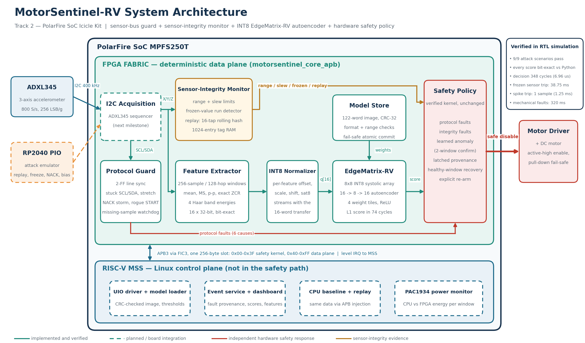

# MotorSentinel-RV

[](https://github.com/shivamtiwari020505/MotorSentinel-RV/actions/workflows/rtl.yml)

MotorSentinel-RV is an attack-resilient predictive-maintenance architecture for
industrial motors, targeting **Track 2 - Connected Real-Time Systems** on the
**PolarFire SoC Icicle Kit**.

The design places sensor-bus monitoring, fixed-point feature extraction, INT8
autoencoder inference, and the final safety decision in FPGA fabric. PolarFire
SoC RISC-V software will manage models, telemetry, visualization, and the CPU
comparison path without being part of the time-critical motor-disable path.

## Highlights

- **Full sample-to-motor data path in fabric.** Accelerometer samples pass
  through sensor-integrity checks, a bit-exact 16-feature extractor, an INT8
  normalizer and the EdgeMatrix-RV autoencoder on an 8x8 systolic array, then
  reach a latched hardware safety policy. Linux is never in the trip path.
- **Learned plus non-learned defenses.** The autoencoder catches mechanical
  faults, bias and noise. A hardware rolling-hash replay detector catches the
  attack a learned model cannot see: replayed *healthy* data.
- **Deterministic timing.** The worst case from the window-closing sample to
  the safety decision is 348 cycles (6.96 us at 50 MHz), with a fixed 74-cycle
  inference.
- **Bit-exact verification.** Every feature, normalized input, hidden
  activation, reconstruction and score matches a standard-library Python
  reference in RTL simulation.

## Verified attack and fault scenarios

End-to-end RTL simulation of the integrated core (`tb/tb_motorsentinel_core.sv`).
Each scenario starts at sample 1,536 at 800 samples/s.

| Scenario | Motor disabled after | Detected by |
| --- | ---: | --- |
| Healthy operation | never (max score 69 vs threshold 118) | - |
| 3x rotor imbalance | 320 ms | EdgeMatrix-RV autoencoder |
| Outer-race bearing fault | 320 ms | EdgeMatrix-RV autoencoder |
| +120 LSB bias injection | 320 ms | EdgeMatrix-RV autoencoder |
| Noise injection | 320 ms | EdgeMatrix-RV autoencoder |
| Frozen sensor value | 38.75 ms | frozen-run and replay detectors |
| Replay of a healthy recording | 160 ms | rolling-hash replay detector (autoencoder max score 55) |
| Spike injection | 1.25 ms (one sample) | slew limit |
| I2C NACK storm | immediate | protocol guard |

The full table, method and verification boundary are in
[Milestone 3](docs/milestone-3.md).

## Implementation status

| Milestone | Scope | Evidence |
| --- | --- | --- |
| [1](docs/milestone-1.md) | APB safety kernel: protocol guard, latched fault provenance, recovery interlock, explicit arm/disarm | 30 self-checks |
| [2](docs/milestone-2.md) | 256-sample/128-hop feature extractor, [bit-exact contract](docs/feature-contract.md) | 112 features bit-exact |
| [3](docs/milestone-3.md) | EdgeMatrix-RV autoencoder, CRC-checked model store, sensor-integrity monitor, integrated `motorsentinel_core_apb` | 96 inferences and 9 scenarios bit-exact |
| Next | ADXL345 I2C sequencer, Libero Tcl overlay, Linux UIO driver, board measurements | - |

The [APB register map](docs/register-map.md) defines the control plane, and the
[Icicle integration baseline](docs/icicle-integration.md) pins the intended
Libero and reference-design flow.

## Run the RTL regression

Icarus Verilog 11 or newer is sufficient.

On Linux:

```sh
make test
```

On Windows PowerShell:

```powershell
powershell -ExecutionPolicy Bypass -File .\scripts\run_rtl_tests.ps1
```

The test runs the Python unit tests, regenerates deterministic golden vectors,
and runs four self-checking RTL simulations: the safety kernel, the feature
extractor, the EdgeMatrix-RV inference engine and the end-to-end attack
scenarios. Use `make waves`, `make feature-waves` or `make core-waves` for
waveforms, or add `-Waves` to the PowerShell command. GitHub Actions runs the
same regression on every push and pull request. The regression needs only the
Python standard library; `make train` retrains the committed model offline and
requires NumPy.

## Repository layout

```text
rtl/       synthesizable SystemVerilog
tb/        self-checking testbenches
scripts/   local verification entry points
sw/        RISC-V software interface definitions
model/     bit-exact Python reference models, motor simulator, trained weights
tools/     vector generation, model training and diagram rendering
tests/     analytic reference-model tests
docs/      architecture, interfaces, and proposal artifacts
```

## Complete data path

1. Acquire signed X/Y/Z vibration samples at 800 samples/s over protected I2C.
2. Check every sample for range, slew, frozen-value and replay attacks.
3. Generate 16 fixed-point features from 256-sample, 50%-overlapped windows.
4. Run a quantized `16 -> 8 -> 16` autoencoder on an 8x8 INT8 matrix engine.
5. Combine protocol faults, integrity faults, and reconstruction error in the
   FPGA safety policy.
6. Report events to Linux while the FPGA can disable the low-voltage
   demonstration motor independently.

Steps 2-6 are implemented and verified in RTL simulation. Step 1's protocol
monitoring is implemented; the ADXL345 acquisition sequencer is next.

## System architecture

[Download the system block diagram as PDF](docs/MotorSentinel-RV_System_Block_Diagram.pdf)



The diagram shows the implemented data plane. Solid blocks are verified in RTL
simulation; dashed blocks are planned board integration. It is regenerated with
`python tools/render_architecture.py`. The original proposal-stage diagram is
preserved in [docs/archive](docs/archive/).

This repository is under active development. The detection results above come
from RTL simulation with deterministic synthetic vibration data. Board-level
timing, utilization, power, and real-motor detection results will be reported
only after measurement on the PolarFire SoC Icicle Kit.
